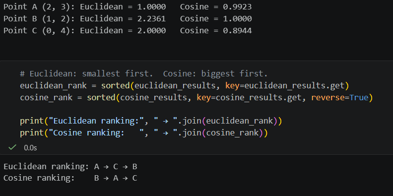
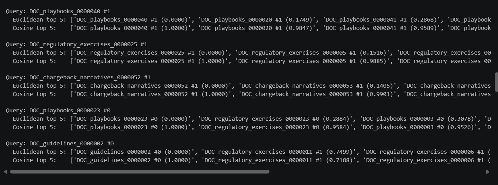
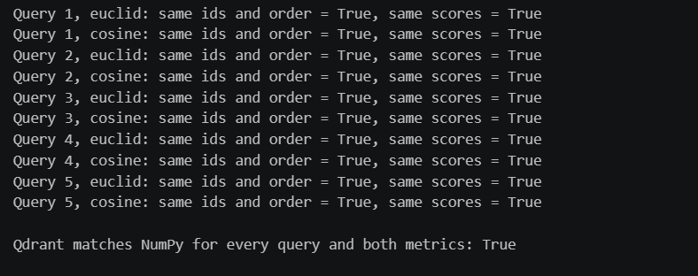
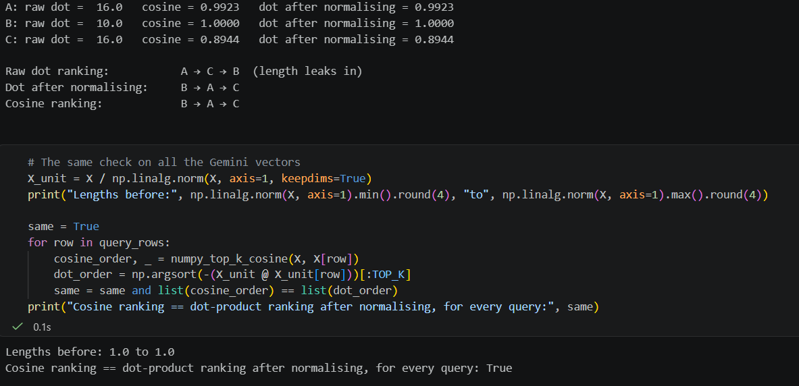
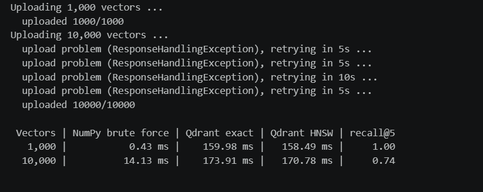

# Vector Similarity by Hand, with NumPy and with Qdrant

How does a vector database find "the closest" vectors? This project works it out step by step. It starts with a 2D example calculated by hand, repeats the same search on real **Gemini Embedding 2** vectors with **NumPy** and with **Qdrant**, shows why normalised vectors make cosine and dot product agree, and times brute force against Qdrant's **HNSW** index.

The notebook [`sentinel_vector_similarity.ipynb`](sentinel_vector_similarity.ipynb) covers the five tasks of the brief:

| # | Task | Notebook section |
|---|---|---|
| 1 | Reproduce the class example by hand: points (2,3), (1,2), (0,4), query (2,4); Euclidean distance and cosine similarity; both rankings | 1 |
| 2 | Brute-force top-k search in NumPy for both metrics over the Gemini Embedding 2 vectors from task 4 | 2 |
| 3 | Run the same queries in Qdrant and show the results match NumPy | 3 |
| 4 | Normalise the vectors and show why cosine and dot product then give the same ranking | 4 |
| 5 | Time brute force against Qdrant for 1,000 and 10,000 vectors; what HNSW changes | 5 |

## Repository structure

```
sentinel-vector-similarity/
├── sentinel_vector_similarity.ipynb   # the notebook (sections 1–5)
├── requirements.txt                   # numpy, qdrant-client, python-dotenv
├── .env.example                       # template for your .env (no secrets)
├── .gitignore                         # keeps .env out of Git
├── screenshots/                       # output screenshots used below
└── README.md
```

## 1. The class example by hand

| Stored point | Vector |
|---|---|
| A | (2, 3) |
| B | (1, 2) |
| C | (0, 4) |
| **Query** | **(2, 4)** |

| Point | Euclidean distance (smaller is closer) | Cosine similarity (bigger is closer) |
|---|---|---|
| A (2, 3) | √((2−2)² + (4−3)²) = **1.0000** | 16 ÷ (√20 × √13) = **0.9923** |
| B (1, 2) | √((2−1)² + (4−2)²) = **2.2361** | 10 ÷ (√20 × √5) = **1.0000** |
| C (0, 4) | √((2−0)² + (4−4)²) = **2.0000** | 16 ÷ (√20 × 4) = **0.8944** |

- **Euclidean ranking:** A → C → B
- **Cosine ranking:** B → A → C

**Why they differ:** B = (1, 2) is exactly half of the query (2, 4). It points the same way, so its cosine is a perfect 1.0000, but its tip is the furthest away. Euclidean distance cares about length; cosine only cares about direction.

## 2–3. NumPy brute force vs Qdrant

- **NumPy brute force** compares each query with every stored vector in one matrix operation, then sorts and keeps the top 5.
- **Qdrant:** one test collection holds two named vectors per point (`cosine` and `euclid`), so the same data can be searched with each distance.
- **Result:** with `exact=True`, Qdrant returned **the same ids in the same order as NumPy for all 5 queries and both metrics**, with the same scores within rounding. Each query (a stored chunk) found itself first (distance 0.0000, cosine 1.0000), then its nearest neighbours: mostly chunks of the same document type, e.g. `DOC_playbooks_0000040` → `DOC_playbooks_0000020` (cosine 0.9847).

## 4. Normalising: cosine equals dot product

Cosine is the dot product divided by both lengths. When every vector is normalised to length 1, both lengths are 1, so:

```
cos(q, v) = (q · v) ÷ (1 × 1) = q · v
```

On the 2D example, the raw dot product ranks **A → C → B** (A and C tie on 16, because length leaks in). After normalising, the dot product equals the cosine exactly and ranks **B → A → C**. Gemini Embedding 2 vectors (3072 dimensions) already have length 1, so cosine, dot product and Euclidean distance all rank them the same way.

## 5. Brute force vs Qdrant timing

Average per query over 20 queries, top 5, on Qdrant Cloud (free tier, eu-central-1):

| N vectors | NumPy brute force | Qdrant exact | Qdrant HNSW | HNSW recall@5 |
|---|---|---|---|---|
| 1,000 | 0.43 ms | 159.98 ms | 158.49 ms | 1.00 |
| 10,000 | 14.13 ms | 173.91 ms | 170.78 ms | 0.74 |

**What the numbers show:**
- **NumPy brute force grew about 33×** (0.43 → 14.13 ms) for 10× more vectors. Brute-force work grows with every vector added, and from 1,000 to 10,000 the data also stops fitting in the fastest CPU cache.
- **Both Qdrant searches took about 160–175 ms at either size.** Almost all of that is the network round trip from this computer to the cluster in Frankfurt (eu-central-1). The search itself added only about 12–14 ms on the server for 10× more data.
- **HNSW recall@5 fell to 0.74 at 10,000 vectors.** HNSW is approximate, and random vectors are its hardest case: in 768 dimensions, random points are all almost the same distance apart, so the graph has no clusters to follow. Real embeddings cluster by topic, which usually gives recall above 0.95. A larger search beam (`hnsw_ef` in `SearchParams`) raises recall at some cost in speed.

The timing vectors are random length-1 vectors with **768 dimensions**, one of Gemini Embedding 2's supported sizes. That keeps the 10,000-vector upload a quarter of the size of 3072-number vectors, so it works on a normal home connection. Search time depends on how many vectors there are and how long they are, not on what they mean. Uploads go in small batches with automatic retries to avoid timeouts. Qdrant Cloud timings include the network round trip, which is the same at every size.

### What an HNSW index changes

**Brute force** compares the query with every vector. The work grows in a straight line with the data: 10× more vectors means about 10× more work. The answer is always exact.

**HNSW** (Hierarchical Navigable Small World) is a graph index that Qdrant builds over the vectors:

- **Structure:** each vector is linked to a few of its nearest neighbours (`m`, default 16). The links are stacked in layers: the top layers have few points and long jumps, the bottom layer has every point and short links.
- **Search:** a query starts at the top, jumps greedily towards closer points and drops a layer when it can't get closer. It finishes with a careful local search on the bottom layer (`ef`). It checks only a few hundred vectors instead of all of them.
- **Speed:** search cost grows roughly with the **logarithm** of N instead of with N. At millions of vectors this is the difference between milliseconds and seconds.
- **Approximate:** HNSW can occasionally miss a true neighbour. Recall is usually above 0.95, can be raised with a larger `ef` or `m` at the cost of speed and memory, and `exact=True` switches it off when a perfect answer is needed.
- **Cost:** building the graph takes time and extra memory. Qdrant only builds it once a segment is large enough (`indexing_threshold`), which is why a fresh collection briefly shows status "yellow" while it indexes.

At SENTINEL's real scale (millions of document chunks, many users at once), brute force becomes too slow, and an index like HNSW is what keeps search fast.

## Setup

1. **Clone the repository**

   ```bash
   git clone https://github.com/mrunalini-gudi/sentinel-vector-similarity.git
   cd sentinel-vector-similarity
   ```

2. **Qdrant Cloud.** Use the free cluster from task 4. Its `sentinel_corpus` collection holds the Gemini Embedding 2 vectors this notebook reads. If that collection is missing, the notebook uses 1,000 new random vectors instead.

3. **Create a virtual environment and install the packages**

   ```bash
   python -m venv sentinelenv
   sentinelenv\Scripts\activate
   pip install -r requirements.txt
   ```

4. **Add your credentials.** Copy `.env.example` to `.env` and fill in `QDRANT_URL` and `QDRANT_API_KEY`:

   ```bash
   copy .env.example .env
   ```

   `.env` is listed in `.gitignore`, so it is never committed.

## How to run

1. Open `sentinel_vector_similarity.ipynb` in VS Code or Jupyter and select the `sentinelenv` kernel.
2. Click **Run All**.
3. Section 5 uploads 10,000 vectors (768 numbers each) to your cluster in small batches and waits for Qdrant to finish indexing before timing, which takes a few minutes.
4. The last cell deletes the test collections the notebook created (`similarity_check`, `timing_1000`, `timing_10000`). Your `sentinel_corpus` collection is kept.

## Screenshots

### Section 1: class example, step by step and rankings


### Section 2: NumPy brute-force top 5


### Section 3: Qdrant matches NumPy


### Section 4: normalising, cosine equals dot product


### Section 5: timing table


## Security

- Keys live only in `.env`, which Git ignores. `.env.example` holds placeholders only.
- If a key is ever pushed by mistake, rotate it straight away in Qdrant Cloud: deleting the file afterwards does not remove it from Git history.
